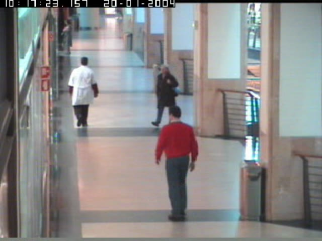
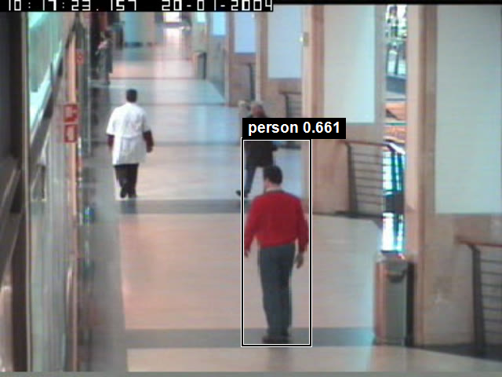
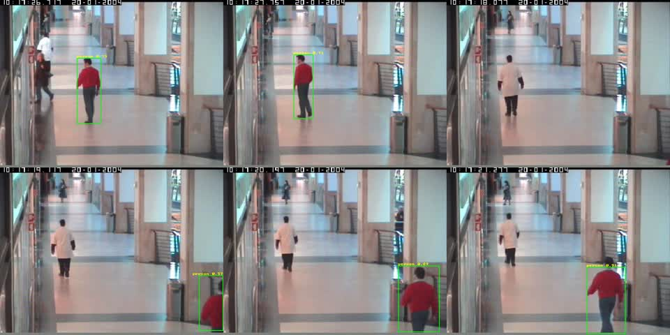

# Edge Vision Analyzer

让 2GB Armbian 魔百盒分析局域网视频，并把事件图片与中文摘要保存在 PC 上。

盒子负责取流、运动过滤、目标检测和实时画面；PC 负责可选的本地视觉模型推理、图片与事件留存。运行时只访问局域网服务，盒子不保存历史事件或失败图片缓存。

## 完整记录：画面、检测与中文摘要

这一节把一次真实运行的四段证据排在一起：输入画面、检测框与分数、本地视觉模型摘要、盒端实时画面。第 1～3 段来自 2026-11-24 的 PC 单帧演示，第 4 段来自同一公开数据集在魔百盒上的取流验收；两段记录不是同一条流水线，各自只证明各自做过的事。

### 1. 输入画面



640×480 JPEG，42,201 字节，CAVIAR `OneStopEnter1cor` 零基第 150 帧（PTS 6.000 秒）。它由 PC 显式投递到隔离的 FastAPI／SQLite 存储，再从 `/api/v1/images/...` 取回并逐字节核对。存储接口保存的始终是干净图，检测框只画在展示用的衍生图上。

### 2. 检测结果



```json
{
  "top_label": "person",
  "top_score": 0.6609150767326355,
  "targets": [
    {
      "label": "person",
      "score": 0.6609150767326355,
      "x": 0.482364, "y": 0.367957,
      "w": 0.135059, "h": 0.547253
    }
  ]
}
```

坐标是相对画面的归一化值，由项目内 NCNN／YOLO-Fastest-v2 模块给出。阈值 0.5 下只检出一个框；画面里还有其他人，所以框数不是人数统计。

### 3. 中文摘要

> 一个人在走廊上行走，另一个人在远处交谈。

本地 Qwen2-VL 经 OpenAI 兼容接口推理，本次客户端请求耗时 10,435 ms。这是模型原文，不是人工事实标注；“交谈”无法从单帧确认。

### 4. 盒端实时画面



CAVIAR 走廊源经 PC 中继推送到魔百盒，盒端在快照 OSD 上直接绘出检测框，拼图中可见 `person 0.94`、`0.92`、`0.91` 等结果；单帧示例见[另一张快照](docs/examples/box-caviar/osd-frame-2026-11-24.jpg)。这次验收把 MAD 阈值临时改为 0.0 以强制检测，默认 8.0 时这段慢速走廊几乎全被运动过滤跳过。2026-11-25 装入 v1.0.1 后以当前测试视频复核：`/api/v1/health` 返回 `version=v1.0.1`，30 秒统计采集 14.9 FPS、丢帧 0、RSS 54.0 MB、SoC 38.9 °C，快照 200／20,361 字节；该次复核输入不是 CAVIAR。

### 5. 复跑与完整 JSON

查询命令、完整事件 JSON 与云存储目录结构见[示例文档](docs/examples/cloud-storage/README.md)和[云存储查询演示](https://github.com/nhh37740-glitch/edge-vision-analyzer/discussions/156)。盒端指标的连续记录在[实测台账](docs/benchmarks.md)。

### 6. 边界与许可

PC 单帧演示不等同盒端自动事件流水线；盒端 OSD 图来自取流验收，现场配置的 LLM 与存储开关当时为关闭。整机重启、长时间运行与真实断网仍未复验。图像来源：**EC Funded CAVIAR project/IST 2001 37540**，[数据集来源页](http://homepages.inf.ed.ac.uk/rbf/CAVIAR/)，序列 `OneStopEnter1cor`；来源页标注 **CC BY-SA**，未注明版本。图中图像经过抽帧、缩放、编码，盒端图另加检测框绘制，均沿用原许可。未使用现场私有画面、凭据或私有配置。

## 可以做什么

- 接入 RTSP、HTTP MJPEG 或本地视频；本地视频可循环，便于脱离手机持续开发。
- 先用帧差过滤静止画面，再用 NCNN／YOLO-Fastest-v2 检测目标。
- 通过 REST 查看状态、切换视频源、调整检测阈值；读取带框快照与 MJPEG，或向外部 MediaMTX 推送 RTSP。
- 按事件异步调用 PC 上的本地视觉模型，并将干净 JPEG、检测框和可选摘要交给 FastAPI／SQLite 保存、分页查询。
- 由 systemd 托管盒端程序，独立使用 Fluent Bit 将服务日志转发至 PC。

## 两台机器如何分工

```text
IP 相机／手机流／本地视频 → Armbian 魔百盒 → 实时快照／MJPEG／RTSP
                              │ 事件图片与检测结果
                              └→ PC：可选本地视觉模型 → 云存储与历史查询
```

魔百盒与 PC 经有线交换机通信。边缘 API 默认 `:8081`，PC 的 `llama-server` 默认 `:8080`，存储服务默认 `:8090`。地址在本地配置中填写，示例地址需要替换为现场地址。

## 已验证到哪一步

2026-11-24 已在 Cortex-A53 四核、约 2GB RAM 的 Armbian 盒上验证本地视频、手机流、RTSP 输入／输出、检测与实时画面、PC 存储及本地模型联动、基础日志转发。

### 性能摘要

| 工况 | 采集 FPS | 进程 RSS | 丢帧 |
| --- | --- | --- | --- |
| 原静态构建，本地 MP4 循环、640×480@15、MAD 8.0、LLM／存储关闭，608 秒窗口（2026-11-24） | 14.9 | 28.4 MB | 0 |
| ARM64 动态发行包，相同视频和配置，108 秒窗口（2026-11-25） | 14.9 | 53.9 MB | 0 |

这是指定工况的实测，不能据此推断所有场景的检测速度或长期稳定性。硬件、提交、工况与其他结果见[实测台账](docs/benchmarks.md)。

ONVIF 目前仅做过 go2rtc 模拟器控制面子集验证，边缘程序没有 ONVIF 客户端。ARM64 离线发行包已在目标机完成部署与运行验收；正式 Release [v1.0.1](https://github.com/nhh37740-glitch/edge-vision-analyzer/releases/tag/v1.0.1) 已于 2026-11-25 发布并安装到目标机，`/api/v1/health` 现报告 `version=v1.0.1`；整机重启恢复与长期运行仍待验收。

## 先在 PC 上运行

下面以 Ubuntu 24.04 的 Bash 为例。项目也已在 Windows 11／MSYS2 UCRT64 构建；Windows 使用对应工具链和开发库，并将运行 DLL 所在目录加入 `PATH`。首次配置需联网获取固定版本 NCNN；测试不下载模型或连接真实摄像头。

准备 C++17 编译器、CMake、Ninja、pkg-config，以及 FFmpeg、cpp-httplib、nlohmann/json、stb 和 GoogleTest 开发包。Ubuntu 可安装：

```sh
sudo apt-get install build-essential cmake ninja-build pkg-config \
  libavformat-dev libavcodec-dev libavutil-dev libswscale-dev \
  libcpp-httplib-dev nlohmann-json3-dev libstb-dev libgtest-dev
```

从仓库根目录构建并运行离线测试：

```sh
git clone https://github.com/nhh37740-glitch/edge-vision-analyzer.git
cd edge-vision-analyzer
cmake -S . -B build-native -G Ninja -DCMAKE_BUILD_TYPE=Release -DBUILD_TESTING=ON
cmake --build build-native --parallel 2
ctest --test-dir build-native --parallel 2 --output-on-failure --no-tests=error
cp config/config.example.json config/config.local.json
```

按[模型说明](models/README.md)准备 YOLO-Fastest-v2 的 `.param`／`.bin`，并自行准备一个可解码的本地视频；模型和录像不随仓库提供。编辑 `config/config.local.json`：将 `input.source` 改为视频路径、`input.loop` 设为 `true`；首次只看实时画面时，将 `llm.enabled` 与 `storage.enabled` 设为 `false`。模型路径也须与实际文件一致。

保持工作目录为仓库根目录，启动程序；Windows 的可执行文件带 `.exe` 后缀：

```sh
./build-native/edge-vision-analyzer --config config/config.local.json
# 在另一终端查看状态；浏览器可打开同一端口的 /api/v1/stream
curl http://127.0.0.1:8081/api/v1/health
curl http://127.0.0.1:8081/api/v1/stats
mkdir -p snapshots
curl -fS http://127.0.0.1:8081/api/v1/snapshot.jpg -o snapshots/snapshot.jpg
```

### 需要保存事件时，再启动 PC 存储

需要 Python 3.10+。以下命令从仓库根目录执行，虚拟环境位于仓库外，仅监听本机回环：

```sh
sudo apt-get install -y python3-venv
python3 -m venv ~/.venvs/edge-cloud
. ~/.venvs/edge-cloud/bin/activate
python -m pip install -r cloud-storage/requirements.txt
python -m uvicorn server:app --app-dir cloud-storage --host 127.0.0.1 --port 8090
```

在另一终端执行 `curl http://127.0.0.1:8090/health`。在本地配置中将 `storage.endpoint` 设为 `http://127.0.0.1:8090/api/v1/events`、`storage.enabled` 设为 `true`，重启边缘程序后，后续检测事件可投递到本机。端点已在启动时配置正确的情况下，也可通过 PATCH 热更新开关，见 [API](docs/api.md)。

盒端联动时，PC 存储需改为监听 PC 的局域网地址，放行对应入站端口，并把盒端配置中的 PC 地址改为该地址。中文摘要还需要独立的 `llama-server`、视觉模型与投影文件；启动参数见[旧版运行说明](docs/archive/README-2026-11-24.md#pc-双服务启动)。

## 部署到魔百盒

盒子只运行程序，不编译大型 C++ 依赖。先在 PC 准备 ARM64 程序、匹配的运行库、模型、输入源和本地配置，再按[部署与服务说明](docs/architecture.md)操作；脚本入口为 [deploy_to_box.sh](scripts/deploy_to_box.sh)。

现有脚本不安装 `lib/`；动态发行包须停服务后先安装同包运行库。构建打包实现已经[PR #151](https://github.com/nhh37740-glitch/edge-vision-analyzer/pull/151)合并，手动 runner 构建、包检查与盒端部署运行结果见[实测台账](docs/benchmarks.md#arm64-发行包构建验收2026-11-24)；正式 Release 已发布，附件与构建结果见 [v1.0.1](https://github.com/nhh37740-glitch/edge-vision-analyzer/releases/tag/v1.0.1)。回退材料仅存 PC，盒端只保留当前运行所需文件。

## 深入阅读

| 想了解的内容 | 入口 |
| --- | --- |
| 架构、网络、节点与资源约束 | [architecture](docs/architecture.md) |
| REST、图片、事件和日志接口 | [API](docs/api.md) · [OpenAPI](docs/openapi.yaml) |
| 里程碑、验收标准与未完成项 | [roadmap](docs/roadmap.md) |
| 硬件和性能证据、已解决的问题 | [benchmarks](docs/benchmarks.md) · [troubleshooting](docs/troubleshooting.md) |
| PC 存储、模型与配置字段 | [存储服务](cloud-storage/README.md) · [模型](models/README.md) · [公开配置](config/config.example.json) |
| 贡献与 Agent 接力规范 | [AGENTS.md](AGENTS.md) |
| 旧首页的完整工程记录 | [2026-11-24 归档](docs/archive/README-2026-11-24.md) |
