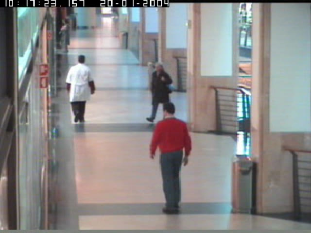
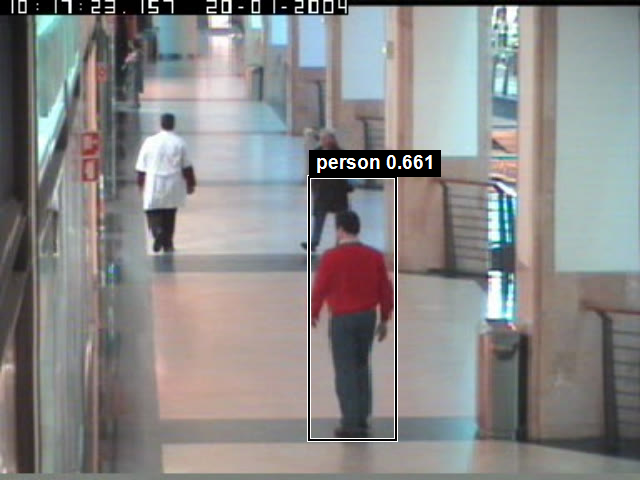

# 云存储查询示例：图片、检测框与中文摘要

这是一条在联想 PC 上生成并实际查询的公开演示记录：CAVIAR 视频抽帧 → 项目 `NcnnDetectorNode` 检测 → 本地 Qwen2-VL 描述 → 显式投递云存储 → 查询事件和 JPEG。它展示存储接口及分析字段，不代表本次在魔百盒运行了自动事件流水线。

GitHub 展示的是本次响应的静态副本；实际 API 查询须连接正在运行的 PC 服务。完整返回值见 [query-response.json](query-response.json)，接口定义见 [API 契约](../../api.md)。

## 查到的干净图片



图片接口返回 `200 image/jpeg`，640×480、42,201 字节；已核对与投递的 JPEG 字节一致。原片 384×288，取零基第 150 帧，FFmpeg `showinfo` 核实 PTS 为 6.000 秒，再双线性缩放到 640×480。图中自带日期属于原始录像；事件的 `timestamp_ms` 是 2026-11-24 本次演示投递时间，`created_at` 为 UTC 入库时间。

## 用实际检测结果标框



这张 PNG 由展示步骤将真实 `targets` 画到查询所得 JPEG 上，标签保留三位小数；云存储保存和返回的仍是上面的干净图。画面可见多个人，本次阈值 0.5 下只检出一个框，不能把框数当成完整人数统计。

| 查询字段 | 本次实际值与含义 |
| --- | --- |
| `event_id` | `demo_caviar_frame150_1795531452594`；PC 显式投递的演示 ID |
| `frame_id` | `150`；本次单帧驱动使用的原片零基帧号 |
| `top_label` / `top_score` | `person` / `0.6609150767326355`，模型检测分数 |
| `targets` | 1 个 `person`；归一化 `x=0.482364`、`y=0.367957`、`w=0.135059`、`h=0.547253`；完整精度见 JSON |
| `llm_summary` | 一个人在走廊上行走，另一个人在远处交谈。 |
| `llm_latency_ms` | `10435.46`；本次客户端请求窗口，含请求组装与往返 |
| `image_url` | `/api/v1/images/2026-11-24/demo_caviar_frame150_1795531452594.jpg`；相对于 PC 存储服务 |
| `created_at` | `2026-11-24 14:44:12`（UTC） |

摘要是模型原文，未人工改写；其中“交谈”无法由这张单帧确认，不能据此认定发生了该行为。检测与文字描述均为模型输出，不是人工标注。

## 查询命令

本次使用独立的临时存储目录与回环端口 `18090`，没有读写现场历史库。以下为实际请求路径；复跑须先启动服务并投递事件，使用自己查询到的 `image_url`。常规部署端口为 `8090`。

```sh
BASE=http://127.0.0.1:18090
curl -fsS "$BASE/health"
# {"status":"ok","db":"connected"}
curl -fsS "$BASE/api/v1/events?limit=1&offset=0"
curl -fS "$BASE/api/v1/images/2026-11-24/demo_caviar_frame150_1795531452594.jpg" \
  -o queried-image.jpg
```

实际结果为 `POST /api/v1/events` 返回 201，列表查询返回 200，图片读取返回 200；列表 `total=1`、`limit=1`、`offset=0`，关联图片可读取。该事件不会自动出现在新建的空数据库中。演示结束后已停止本次临时存储及模型服务。

## 分析方法与边界

检测在 Windows／MSYS2 PC 上直接调用项目已编译的 `NcnnDetectorNode`，读取同一帧 RGB24：YOLO-Fastest-v2、fp32、2 线程、输入 320、置信度阈值 0.5，仅保留 `person`。本次单帧检测耗时 48.32 ms，仅是 PC 单次运行值；没有运行 CaptureNode、EventTracker 或 GenAiWorker，事件由演示客户端显式组装投递。JPEG 从该 RGB 帧编码，检测框作用于同一画面。

摘要由本地 `llama-server` 的 Qwen2-VL-2B-Instruct Q4_K_M 与 Q8_0 多模态投影生成，`image-max-tokens=64`、2 个 CPU 线程、`max_tokens=128`、`temperature=0.2`，输入就是上述干净 JPEG。提示词为“用一句简短的中文描述画面中人物正在做什么。”；不使用公网推理 API。本次不新增接口、前端或常驻服务，不把单帧结果当作盒端性能基准。

## 图像来源与许可

图像来自 **EC Funded CAVIAR project/IST 2001 37540**，序列 `OneStopEnter1cor`。见[数据集来源页](http://homepages.inf.ed.ac.uk/rbf/CAVIAR/)及[原视频](https://homepages.inf.ed.ac.uk/rbf/CAVIARDATA2/OneStopEnter1cor/OneStopEnter1cor.mpg)。来源页标注 **Creative Commons BY-SA**，未注明版本。

本示例进行了抽帧、缩放和 JPEG 编码，标框图另添加检测框与标签；`clean.jpg` 与 `annotated.png` 及其图像衍生版本沿用原数据的 CC BY-SA 许可。检测结果与摘要为本项目独立运行输出，不是 CAVIAR 官方标注。示例未使用现场私有影像、设备标识、凭据或本地私有配置。
